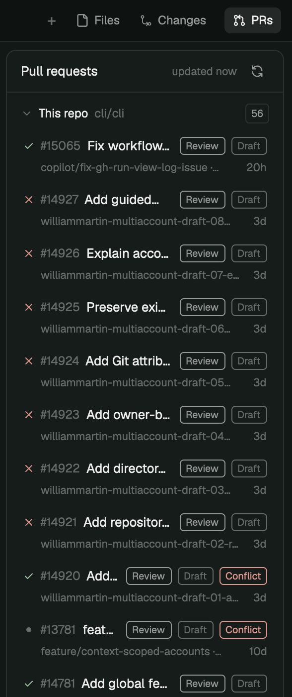

# Pull requests

A **Pull requests** side panel for the Herdr app. It sits beside the
shipped Files and Changes panels and opens from a **PRs** button in the tab
bar. It shows three lists:

- the open PRs of the repo your focused terminal is in;
- PRs waiting for your review;
- your own open PRs across GitHub.

Each PR carries its CI result, its review state, and Draft and Conflict
badges. It needs nothing but the `gh` CLI, logged in.

## What you see

### Tab bar: the PRs button

The button sits right of the shipped Files and Changes buttons, in its own
68 px block beside the stock `tabs` block.

- **Look:** a pull-request icon (14 px) and the label "PRs" (12 px). It is
  26 px tall, with 8 px side padding, a 5 px gap and 6 px corners.
- **Colours:** on a `chrome` background with a 1 px `border` line at the
  bottom, so it continues the tab bar.
- **When the panel shows PRs:** `selected` background and `foreground`
  text.
- **Otherwise:** `chrome` background and `muted` text. Hover gives a
  `hover` background.

### Side panel: the "Pull requests" card

- **Where:** the shipped right-hand panel column of the `main` layout,
  default 368 px wide.
- **Card:** a `background` card with 10 px corners and a 1 px `border`.
  Text is 13 px.
- **Header** (42 px, 14 px side padding):
  - "Pull requests" in semibold;
  - on the right, "updated 2m" in `dim` 11 px;
  - a 24 px refresh button holding a 14 px refresh icon. While a fetch
    runs, the icon becomes a spinner turning every 900 ms.
- **Body:** one scroll area with 6 px padding, holding three sections
  8 px apart, in this order:
  1. **This repo**, with the repo's `owner/name` in `dim` after the title;
  2. **Review requested**;
  3. **Mine**.
- **Section header** (30 px):
  - a 12 px chevron (down when open, right when collapsed);
  - the title in 12 px semibold;
  - on the right, the total in a 10 px pill with a 1 px `border`.
- **Section footer:** "Showing 30 of N" when a list has more than 30 PRs.
- **Row** (10 px side padding, 6 px vertical padding, 7 px corners;
  `hover` background):
  - **Line 1:**
    - a 12 px CI mark: `ansi2` check when passing, `ansi1` cross when
      failing or errored, a `working` dot when pending, a `dim` dot with
      no checks;
    - `#number` in `dim` 12 px;
    - the title, truncated;
    - badges on the right: 10 px text, a 1 px border in the badge's
      colour, 4 px corners.

    | Badge | Colour | When |
    |---|---|---|
    | Approved | `ansi2` | review decision |
    | Changes | `ansi1` | review decision |
    | Review | `muted` | review decision |
    | Draft | `dim` | draft PR |
    | Conflict | `ansi1` | merge conflict |

  - **Line 2** (`dim` 11 px, indented 18 px):
    - where the PR comes from, truncated: `branch · @author` in This repo,
      `owner/repo · @author` in Review requested, `owner/repo` in Mine;
    - how long ago it was updated (`now`, `5m`, `3h`, `7d`, `2mo`, `1y`),
      pinned to the right.
- **Notes and errors:**

  | Situation | Shown as |
  |---|---|
  | This repo can't show PRs | one `dim` line: "No folder", "Not a git repository", "No GitHub remote" or "Can't read this folder: …" |
  | Empty list | "No open pull requests" |
  | `gh` missing | the body reads "Install the GitHub CLI (gh) to see pull requests" |
  | Not logged in or token revoked | the body reads "Run `gh auth login` in a terminal" |
  | First load fails | "Couldn't load pull requests: <reason>" |
  | A later refresh fails | the old lists stay; the header turns `ansi1` "Couldn't refresh", and the reason shows in an 11 px `ansi1` footer |

## How it behaves

- **Agent statuses:** the mod shows no agent status (working, blocked,
  done, idle). It follows only which terminal is focused.
- **This repo follows focus**, like Changes:
  - It uses the focused pane's live folder and machine, including spaces on
    remote machines; `git` runs there.
  - The repo comes from the `upstream` remote if it is on GitHub, else
    `origin`, so a fork shows its parent.
- **One GitHub call per refresh.** A single `gh api graphql` call fetches
  all three lists, at most 30 each.
- **Refresh timing:**
  - every 60 s while the panel shows PRs, and never while it's hidden;
  - on focus moving to another repo. A folder inside the same repo
    doesn't count.
  - on the refresh button, always.
  - After a failure, the next try still waits 60 s.
- **Clicks:**
  - a row opens the PR in the browser (`open`, only `https://github.com`
    links);
  - a section header collapses or expands that list, remembered per list;
  - the PRs button toggles the panel.
- **Open or closed is global.**
  - PRs stays open while you switch spaces, until you close it or pick
    Files or Changes.
  - The stock tab bar restores each space's own panel on a switch and
    closes the unknown `gh-prs`. For 1.5 s after a space switch, the button
    treats a closed PRs panel as the tab bar's doing and reopens it. The
    panel may blink for a frame.
  - While PRs is open it wins over a space's remembered Files or Changes.
- **No keys.** The mod binds no keys and writes no shared state.

## Built from

- **The layout is derived from the stock `main`, not copied.**
  `scripts/make-layout.mjs` reads `layouts/main.json` and writes
  `layouts/main-prs.json` with two edits, found by id:
  1. It appends `{ "id": "gh-prs", "type": "block", "content": { "mod": "gh-prs" } }`
     to the children of the `panel-body` stack, inside the `panel` column.
  2. It wraps the `tabs` block in
     `{ "id": "tabs-row", "type": "row", "size": <tabs' size>, "resizable": false }`.
     The row's children are:
     - the original `tabs` block, now `size: { "weight": 1 }`;
     - `{ "id": "gh-prs-button", "type": "block", "size": { "px": 68 }, "window_drag": true, "content": { "mod": "gh-prs", "props": { "button": true } } }`.

  The edit is idempotent and records `cloned_from`. It refuses with a clear
  message if `panel`, `panel-body` (a stack) or `tabs` is missing.
- **One mod, `mods/gh-prs`, two roles**, chosen by `props().button`:
  - the panel: `panel.js` (data) and `panel-view.js` (drawing);
  - the button: `button.js`.

  Pure modules hold the logic:

  | Module | Holds |
  |---|---|
  | `repo.js` | remote parsing, finding the repo |
  | `github.js` | query, arguments, parsing, failure kinds |
  | `format.js` | times, CI marks, badges, copy |
  | `state.js` | fetch state, pacing, sections |
  | `memory.js` | the global open/closed state |
  | `layout-state.js` | ids, `isPanelShown` |

- **Shipped mods used, unchanged:**
  - `tabs`: the tab bar beside the button;
  - `files` and `changes`: the other panels in the same stack.
- **`herdr` functions:**
  - data: `spaces`, `panes`, `focused`, `layout`, `theme`, `props`;
  - actions and checks: `exec`, `run`, `checking`;
  - storage: `localStorage`, per copy, holding collapsed lists and
    open/closed.
- **Commands:** `layout.select { stack: "panel-body", child: "gh-prs" }`,
  `layout.show { id: "panel" }`, `layout.hide { id: "panel" }`.
- **Programs:**
  - `git rev-parse --show-toplevel` and `git remote get-url`, with
    `on: machine`;
  - `gh api graphql -f query=… -f mine=… -f review=… [-f owner=… -f name=…]`,
    run locally;
  - `open <url>`.
- **The three searches:**
  - `repository(owner, name) { pullRequests(states: OPEN, first: 30, orderBy: UPDATED_AT DESC) }`
  - `search(query: "is:pr is:open review-requested:@me archived:false sort:updated-desc", type: ISSUE, first: 30)`
  - `search(query: "is:pr is:open author:@me archived:false sort:updated-desc", type: ISSUE, first: 30)`

  Each PR reads number, title, url, isDraft, reviewDecision, mergeable,
  updatedAt, headRefName, author, repository, and the last commit's
  `statusCheckRollup.state`.
- **Art:** eight 24×24 stroke SVGs in `mods/gh-prs/icons/`, drawn with
  `svg()` so they take the text colour: pull-request, check, x, dot,
  refresh, spinner, chevron-right, chevron-down.

## Watch out

**Loading and installing**

- **Copy the mod; don't symlink it.** Herdr loads a symlinked mod folder
  once and never hot-reloads it. `scripts/install.sh` copies with rsync,
  and is re-run to sync edits.
- **Read layout props with `props()` from `herdr`.** The first argument
  of `init` doesn't carry them.
- **Don't edit `main` or the shipped mods.** Herdr restores them on start.
  To change `main`, derive a new layout from it; re-running the script
  after a Herdr update brings `main`'s changes along.

**The tab bar**

- **Never add `gh-prs` to `shared("workspace.panels")`.** The `tabs` mod
  keeps one per-space panel store for every layout, so stock `main` would
  try to select a child it doesn't have.
- **The `tabs` mod closes any panel id it doesn't know** when it restores
  a space. Global open/closed works around it from the button; see How it
  behaves.
- **Stop the press on the button.** Its block has `window_drag`, so stop
  the button's mouse-down or a click drags the window.

**`gh` and GitHub**

- **`gh` can exit 1 with good data.** A missing repo comes back as a
  GraphQL body with `data` and `errors`; read stdout first.
- **A revoked token is JSON too.** It prints a JSON 401 body on stdout and
  exits 1; classify that from stderr as "not logged in".
- **One inaccessible PR** (a SAML-protected org) arrives as a `null` node
  beside an error. Drop the node and keep the list; only an empty section
  is an error.
- **Use `-f`, never `-F`.** `-F` turns a repo named `123` into a number.

**Rendering and timing**

- **Pace from the last attempt, not the last success.** Otherwise a
  failure retries on every render.
- **Rows need automatic height.** A fixed 44 px clips the second line.
- **`herdr-app check` only renders the "Loading…" state.** Look at rows,
  badges and sections in the running app with `herdr-app shot`.

**Limits**

- github.com only.
- 30 PRs per list.
- The button sits right of the window buttons on Linux and Windows.
- Only the active `gh` account.

## Done when

**Automated**

- `npm test` passes. The tests drive the real `panel.js` and `button.js`
  through a stand-in host, and run `install.sh` and `uninstall.sh`
  against a throwaway Herdr home.
- `herdr-app check ~/.config/herdr-app/mods/gh-prs` passes.
- `herdr-app status` shows layout `main-prs` and no errors.

**In the app**

- The PRs button sits right of Changes. Clicking it shows the panel and
  highlights the button; clicking again hides it.
- **This repo:**
  - in a repo with open PRs, it lists them with CI marks and badges;
  - in a folder that isn't a repo, it shows "Not a git repository", and
    Mine still lists your PRs.
- **Review requested** lists PRs waiting for your review, or "No open
  pull requests".
- **Global open/closed:**
  - opening PRs, switching to another space and back leaves it open both
    times;
  - closing it, then switching, leaves it closed.
- **Refresh rules:**
  - with the panel hidden, no `gh api graphql` process starts over 75 s;
  - with it shown, one starts about once a minute.
- **Install and uninstall:**
  - re-running `install.sh` is idempotent;
  - stock `main` shows no PRs button and no errors;
  - `uninstall.sh` returns to `main` and removes the mod and its saved
    state.
